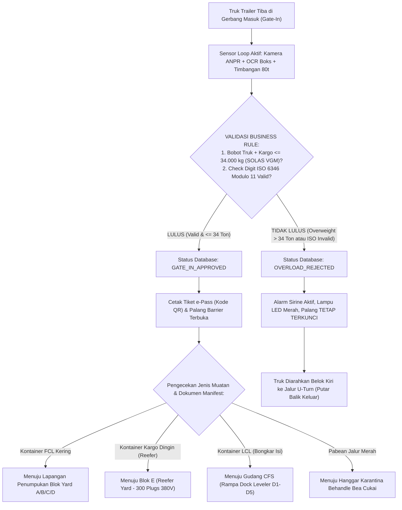
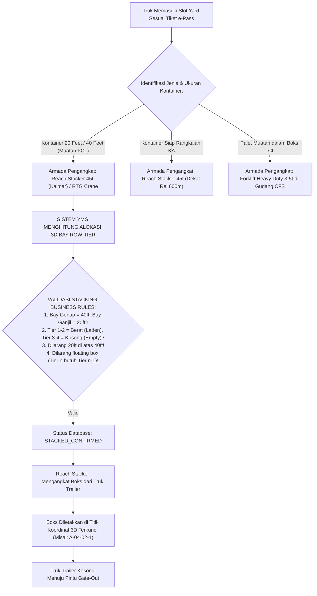
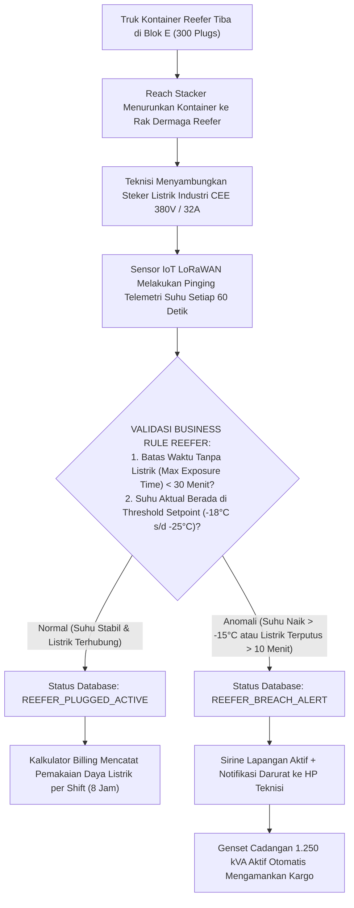
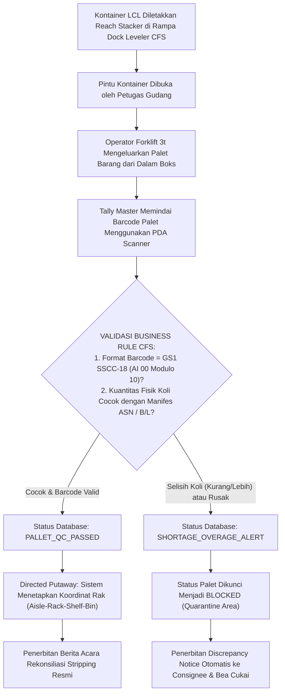
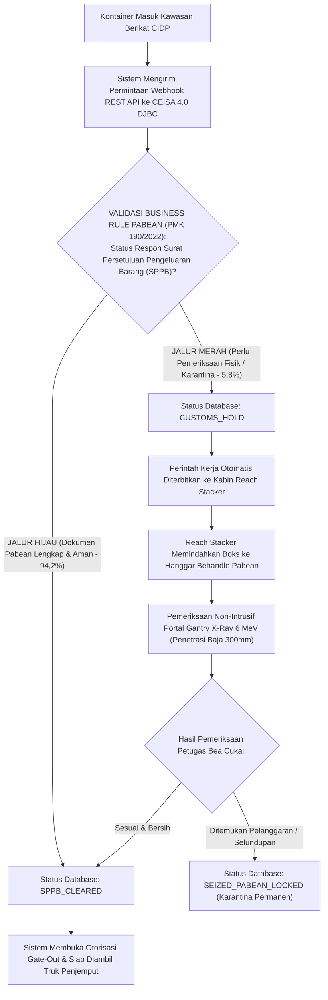
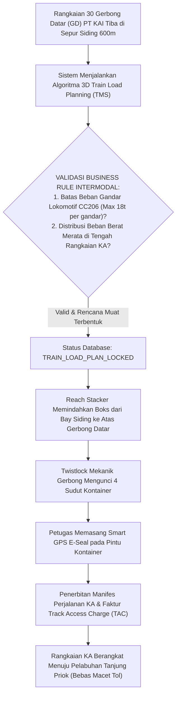
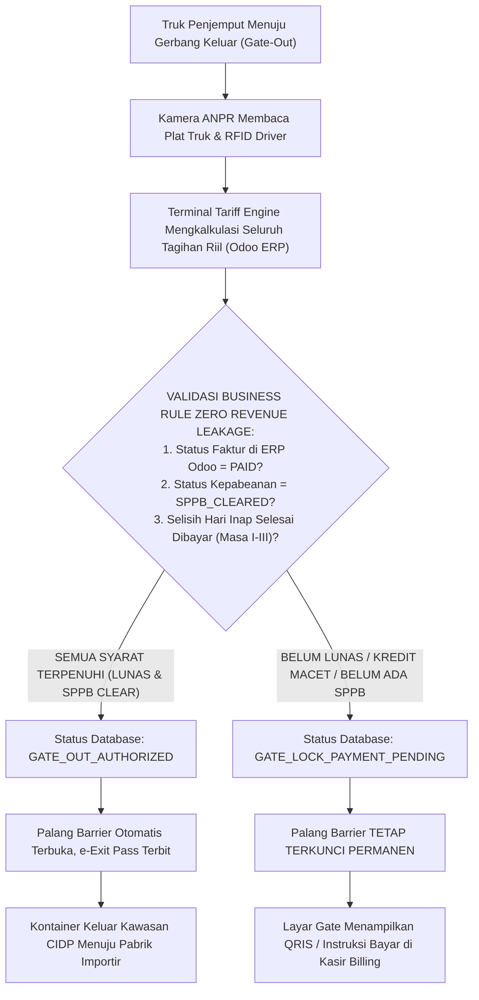

# 📘 CETAK BIRU ALUR PROSES BISNIS & ATURAN BISNIS (BUSINESS RULES)
## Prototype Conclusion Intermodal Dry Port (CIDP) 35 Ha
### Mengubah Fitur Software (WMS, WCS, YMS, TMS, ERP) Menjadi Aturan Bisnis & Spesifikasi Fungsional

* **Mata Kuliah:** Teknologi dan Perangkat Lunak Logistik
* **Dosen Pengampu:** Dr. Tigor Franky, S.T., M.T. (ITL Trisakti)
* **Entitas Konsultan:** Conclusion Supply Chain Consultant
* **Tim Business Analyst & QA:** Naufal Andika Heditya (Lead BA & QA) & Zulfikar Jafarudin Fatah (Lead Architect)
* **Dasar Metodologi:** Modul Perkuliahan Perangkat Lunak Logistik — *Pemetaan Fitur Menjadi Business Rules, Validasi Sistem, Exception Handling, dan FSD*

---

# DAFTAR ISI ALUR PROSES BISNIS (END-TO-END FLOWS)

1. [PARADIGMA BUSINESS ANALYST: DEVELOPER VS BA](#1-paradigma-business-analyst-developer-vs-ba)
2. [FLOW 1: GERBANG MASUK & TIMBANGAN DINAMIS (WCS + YMS)](#flow-1-gerbang-masuk--timbangan-dinamis-wcs--yms)
3. [FLOW 2: PENGANGKATAN & PENEMPATAN YARD 3D BAY-ROW-TIER (YMS + WCS)](#flow-2-pengangkatan--penempatan-yard-3d-bay-row-tier-yms--wcs)
4. [FLOW 3: RANTAI DINGIN REEFER MONITORING & DAYA LISTRIK 380V (WMS + WCS + YMS)](#flow-3-rantai-dingin-reefer-monitoring--daya-listrik-380v-wms--wcs--yms)
5. [FLOW 4: GUDANG CFS INBOUND STRIPPING & PALLET TRACKING GS1 (WMS + WCS)](#flow-4-gudang-cfs-inbound-stripping--pallet-tracking-gs1-wms--wcs)
6. [FLOW 5: KEPATUHAN PABEAN CEISA 4.0 & KARANTINA BEHANDLE (ERP + CUSTOMS)](#flow-5-kepatuhan-pabean-ceisa-40--karantina-behandle-erp--customs)
7. [FLOW 6: INTERMODAL KERETA API REL SIDING 600M (TMS + YMS)](#flow-6-intermodal-kereta-api-rel-siding-600m-tms--yms)
8. [FLOW 7: PENAGIHAN BIAYA & PENGUNCIAN GERBANG KELUAR (ERP + YMS GATE)](#flow-7-penagihan-biaya--penguncian-gerbang-keluar-erp--yms-gate)
9. [MATRIKS PENANGANAN ANOMALI (EXCEPTION HANDLING MATRIX)](#9-matriks-penanganan-anomali-exception-handling-matrix)
10. [PEMETAAN ARSITEKTUR 5 MODUL SISTEM TERPADU (WMS, WCS, YMS, TMS, ERP)](#10-pemetaan-arsitektur-5-modul-sistem-terpadu)

---

# 1. PARADIGMA BUSINESS ANALYST: DEVELOPER VS BA

Dalam perancangan software logistik CIDP, kita membedakan secara tegas antara cara pandang **Developer** dan **Business Analyst (BA)**:

```
┌──────────────────────────────────────────────┐       ┌──────────────────────────────────────────────┐
│        PENDEKATAN DEVELOPER (TEKNIS)         │  VS   │       PENDEKATAN BUSINESS ANALYST (BA)       │
├──────────────────────────────────────────────┤       ├──────────────────────────────────────────────┤
│ • Fokus pada koding & tombol antarmuka UI   │       │ • Fokus pada logika bisnis & parameter input │
│ • "Membuat tombol Submit Gate-In"            │       │ • "Validasi berat kotor <= 34t (SOLAS VGM)"   │
│ • "Menampilkan canvas 3D kubus boks kontainer"│      │ • "Aturan gravitasi & berat terbesar di bawah│
│ • "Menyimpan data string ke tabel database"  │       │ • "Dampak finansial, denda dwell, dan SPPB"  │
└──────────────────────────────────────────────┘       └──────────────────────────────────────────────┘
```

### Rumus 3-Langkah Analisis Fitur BA (Standar Dr. Tigor Franky):
Setiap proses bisnis di CIDP dijabarkan menggunakan format baku:
1. **FITUR / EVENT TRIGGER:** Pemicu fisik atau tombol antarmuka yang diakses aktor.
2. **VALIDASI BUSINESS RULE:** Logika verifikasi, batasan parameter, regulasi hukum, dan formula validasi.
3. **DAMPAK / PEMBARUAN STATUS SISTEM:** Perubahan status record di database dan aksi fisik mesin di lapangan.

---

# FLOW 1: GERBANG MASUK & TIMBANGAN DINAMIS (WCS + YMS)

Menjawab pertanyaan Salwa: *"Truk masuk timbangan, jika lulus dia ke mana jika tidak ke mana?"*



### Rincian Analisis BA (FSD Gate-In):
* **Modul Aplikasi:** [`pages/gate.php`](file:///d:/xampp/htdocs/Conclusion_Intermodal_Dry_Port/pages/gate.php)
* **Kategori Modul:** WCS (Hardware Ingestion) & YMS (Gate Management).
* **Aktor & Alat:**
  * Supir Truk Trailer (*External Driver*).
  * Petugas Gerbang (*Gate Officer*).
  * Alat: Kamera ANPR Plat Nomor, Kamera OCR Boks, Jembatan Timbang Pitless 80 Ton (Load Cell Avery Weigh-Tronix).
* **3 Langkah Analisis BA:**
  1. **Fitur:** *Automated Gate Ingestion & Weight Verification*.
  2. **Validasi Business Rule:**
     - Berat Kotor Total $\le 34.000\text{ kg}$ (Kepatuhan UU No. 22/2009 LLAJ & IMO SOLAS Bab VI Regulasi 2).
     - Format Kontainer = 4 Huruf Kapital + 7 Angka. Karakter ke-11 wajib cocok dengan hasil algoritma bobot Modulo 11.
  3. **Pembaruan Status & Dampak Sistem:**
     - *Jika Lolos:* Status boks di database menjadi `IN_YARD_GATE_IN`, rute diarahkan ke slot yard, supir menerima e-Pass QR. Waktu gerbang pangkas dari 15 menit $\rightarrow$ 90 detik.
     - *Jika Gagal:* Status boks `OVERLOAD_REJECTED`, palang terkunci rapat, supir diarahkan putar balik keluar (*Bypass U-Turn Lane*). Mencegah jalan beton K-450 amblas dan bebas tuntutan hukum maritim internasional.

---

# FLOW 2: PENGANGKATAN & PENEMPATAN YARD 3D BAY-ROW-TIER (YMS + WCS)

Menjawab pertanyaan Salwa: *"Siapa yang ngangkat, kontainer 40 feet siapa yang angkat, penempatannya seperti apa?"*



### Rincian Analisis BA (FSD Yard & Stacking):
* **Modul Aplikasi:** [`pages/yard.php`](file:///d:/xampp/htdocs/Conclusion_Intermodal_Dry_Port/pages/yard.php) & [`pages/simulator.php`](file:///d:/xampp/htdocs/Conclusion_Intermodal_Dry_Port/pages/simulator.php)
* **Kategori Modul:** YMS (Yard Management Engine).
* **Aktor & Alat:**
  * Operator Reach Stacker (bersertifikat SIO Kemenaker Kelas II).
  * Operator RTG Crane (di kabin gantry 18 meter).
  * Alat: 3 Unit Kalmar Reach Stacker DRG450 (Kapasitas angkat 45 Ton dengan Spreader Teleskopik hidrolik 20ft/40ft) dan 1 Unit Konecranes Electric RTG Crane 16-roda.
* **3 Langkah Analisis BA:**
  1. **Fitur:** *3D Stacking Bay-Row-Tier Assignment Engine*.
  2. **Validasi Business Rule:**
     - **Aturan Panjang (Bay Allocation):** Kontainer 20ft ditempatkan di Bay Ganjil (`01, 03, 05`); Kontainer 40ft ditempatkan di Bay Genap (`02, 06, 10`) karena mengunci 2 bay 20ft sekaligus.
     - **Aturan Ketinggian & Sudut Kunci (Corner Casting Rule):** Kontainer 20ft **DILARANG KERAS** ditaruh di atas kontainer 40ft (karena sudut baja kontainer 20ft akan menekan atap tengah kontainer 40ft dan menjebol boks).
     - **Aturan Gravitasi (Anti-Floating Rule):** Larangan menaruh boks di Tier 2/3/4 jika Tier di bawahnya belum terisi.
     - **Aturan Bobot (Heavy-at-Bottom):** Boks bermuatan penuh (*Laden* bobot 20–30 Ton) wajib di Tier 1 atau Tier 2. Boks kosong (*Empty* $<4$ Ton) ditaruh di Tier 3 atau 4.
  3. **Pembaruan Status & Dampak Sistem:**
     - Status slot boks menjadi `OCCUPIED_LOCKED`. Koordinat 3D terkirim ke komputer kabin operator Reach Stacker.
     - Rasio gerak derek turun drastis dari 1.8 moves/box $\rightarrow$ **1.1 moves/box**, menghemat solar BBM HSD sebesar 22% (Rp 1,06 Miliar per tahun).

---

# FLOW 3: RANTAI DINGIN REEFER MONITORING & DAYA LISTRIK 380V (WMS + WCS + YMS)

Menjawab kebutuhan kargo khusus: *Kontainer berpendingin (vaksin farmasi, daging beku, seafood ekspor).*



### Rincian Analisis BA (FSD Cold Chain Reefer):
* **Modul Aplikasi:** [`pages/reefer.php`](file:///d:/xampp/htdocs/Conclusion_Intermodal_Dry_Port/pages/reefer.php)
* **Kategori Modul:** WMS (Cold Storage Strategy) & WCS (Power & Temperature IoT Control).
* **Aktor & Alat:**
  * Teknisi Listrik & Reefer Yard Specialist.
  * Operator Reach Stacker.
  * Alat: 300 Soket Industri CEE Mennekes 380V/32A, Trafo Distribusi PLN 1.250 kVA, Sensor Suhu Digital IoT LoRaWAN.
* **3 Langkah Analisis BA:**
  1. **Fitur:** *Continuous Cold Chain Telemetry & Power Logging*.
  2. **Validasi Business Rule:**
     - *Max Exposure Time:* Batas toleransi kontainer reefer berada di atas truk tanpa aliran listrik maksimal 30 menit.
     - *Temperature Threshold:* Suhu kargo beku (*frozen*) wajib terjaga antara $-18^\circ\text{C}$ s.d. $-25^\circ\text{C}$ dengan deviasi toleransi maksimal $\pm 2^\circ\text{C}$.
  3. **Pembaruan Status & Dampak Sistem:**
     - Sistem mencatat log telemetri suhu detik-per-detik untuk bukti kepatuhan sertifikasi HACCP/ISO 22000.
     - Terminal terhindar 100% dari risiko klaim ganti rugi muatan rusak dari pemilik kargo yang bernilai hingga $\$100.000+$ per kontainer. Tarif sewa steker Rp 250.000/shift tercatat otomatis ke modul penagihan.

---

# FLOW 4: GUDANG CFS INBOUND STRIPPING & PALLET TRACKING GS1 (WMS + WCS)

Menjawab penanganan kargo LCL: *Barang campuran banyak importir dalam 1 kontainer baja.*



### Rincian Analisis BA (FSD CFS Warehouse):
* **Modul Aplikasi:** [`pages/cfs.php`](file:///d:/xampp/htdocs/Conclusion_Intermodal_Dry_Port/pages/cfs.php) & [`pages/scanner.php`](file:///d:/xampp/htdocs/Conclusion_Intermodal_Dry_Port/pages/scanner.php)
* **Kategori Modul:** WMS (Warehouse Inbound & Inventory Tracking).
* **Aktor & Alat:**
  * Tally Master Gudang & Supervisor CFS.
  * Operator Forklift Gudang (Kapasitas 3 Ton).
  * Alat: Rampa Dock Leveler Hidrolik (D1-D5), Scanner Barcode PDA Kamera Optik, Rak Baja Heavy Duty Gudang 4.000 m².
* **3 Langkah Analisis BA:**
  1. **Fitur:** *AIDC Scanning & ASN Matching Engine*.
  2. **Validasi Business Rule:**
     - Standar Barcode = **GS1-128 Application Identifier AI `(00)` Serial Shipping Container Code (SSCC-18)** dengan verifikasi check digit Modulo 10.
     - *Blind Counting Rule:* Tally master wajib menghitung fisik murni tanpa melihat jumlah ekspektasi terlebih dahulu untuk mencegah kecurangan (*fraud*).
  3. **Pembaruan Status & Dampak Sistem:**
     - Palet terpetakan 100% (*traceability*) ke sel rak bin gudang.
     - Status stok otomatis `BLOCKED` jika ada kemasan rusak atau segel curiga, sehingga tidak bisa keluar gudang sebelum lolos inspeksi fisik.

---

# FLOW 5: KEPATUHAN PABEAN CEISA 4.0 & KARANTINA BEHANDLE (ERP + CUSTOMS)

Menjawab integrasi regulasi pabean: *Pemisahan Jalur Hijau vs Jalur Merah Ditjen Bea dan Cukai.*



### Rincian Analisis BA (FSD Kepabeanan):
* **Modul Aplikasi:** [`pages/customs.php`](file:///d:/xampp/htdocs/Conclusion_Intermodal_Dry_Port/pages/customs.php)
* **Kategori Modul:** ERP / Customs Integration Gateway.
* **Aktor & Alat:**
  * Pejabat Pemeriksa Bea dan Cukai (Customs Officer).
  * Operator Reach Stacker.
  * Alat: Portal Gantry X-Ray 6 MeV, Server Gateway Webhook CEISA 4.0, Segel Elektronik Smart GPS E-Seal.
* **3 Langkah Analisis BA:**
  1. **Fitur:** *Automated Customs Bifurcation & Webhook Clearance*.
  2. **Validasi Business Rule:**
     - Berdasarkan Peraturan Menteri Keuangan **PMK No. 190/PMK.04/2022**.
     - Kontainer berstatus `CUSTOMS_HOLD` secara mutlak dilarang diangkut keluar gerbang (*Gate-Out lock*) sebelum ada rilis elektronik berkas SPPB dari sistem DJBC.
  3. **Pembaruan Status & Dampak Sistem:**
     - Kontainer Jalur Hijau rilis instan dalam $<5$ menit (efisiensi 95% dibanding manual 24-48 jam).
     - Alur pemeriksaan fisik boks Jalur Merah terisolasi rapi di hanggar khusus tanpa mengganggu lalu lintas kontainer ekspor-impor lainnya.

---

# FLOW 6: INTERMODAL KERETA API REL SIDING 600M (TMS + YMS)

Menjawab perpindahan antar-moda: *Dari lapangan penumpukan ke atas gerbong kereta api koridor Tanjung Priok.*



### Rincian Analisis BA (FSD Intermodal Kereta Api):
* **Modul Aplikasi:** [`pages/yard.php`](file:///d:/xampp/htdocs/Conclusion_Intermodal_Dry_Port/pages/yard.php) & [`dashboard.php`](file:///d:/xampp/htdocs/Conclusion_Intermodal_Dry_Port/dashboard.php)
* **Kategori Modul:** TMS (Rail Intermodal Scheduling) & YMS (Track Access).
* **Aktor & Alat:**
  * Petugas Langsir & Pengatur Perjalanan Kereta Api (PPKA) PT KAI.
  * Operator Reach Stacker.
  * Alat: 2 Jalur Rel R54 Sepur Simpan 600 meter, Lokomotif CC206, 30 Gerbong Datar (PPCW), Smart GPS E-Seal.
* **3 Langkah Analisis BA:**
  1. **Fitur:** *Rail Load Planning & Axle Load Distribution*.
  2. **Validasi Business Rule:**
     - Beban gandar lokomotif maksimum 18 Ton per gandar (Standar Ditjen Perkeretaapian Kemenhub).
     - Penghitungan bagi hasil sewa prasarana rel kereta api (*Track Access Charge*) sesuai **PM No. 62 Tahun 2018 Kemenhub**.
  3. **Pembaruan Status & Dampak Sistem:**
     - 1 Rangkaian kereta mengangkut 60 TEU sekaligus, memangkas 60 truk trailer dari kepadatan jalan Tol Jakarta-Cikampek.
     - Kepastian waktu tempuh Cikarang–Tanjung Priok stabil pada 90 menit tanpa risiko kemacetan jalan arteri.

---

# FLOW 7: PENAGIHAN BIAYA & PENGUNCIAN GERBANG KELUAR (ERP + YMS GATE)

Menjawab pencegahan kebocoran pendapatan: *Strategi Zero Revenue Leakage di Gate-Out.*



### Rincian Analisis BA (FSD Billing & Gate-Out):
* **Modul Aplikasi:** [`pages/billing.php`](file:///d:/xampp/htdocs/Conclusion_Intermodal_Dry_Port/pages/billing.php) & [`pages/gate.php`](file:///d:/xampp/htdocs/Conclusion_Intermodal_Dry_Port/pages/gate.php)
* **Kategori Modul:** ERP (Odoo Finance Integration) & YMS (Gate-Out Interlock).
* **Aktor & Alat:**
  * Kasir / Finance Officer & Supir Truk Penjemput.
  * Alat: Portal Palang Barrier Otomatis Magnetic Autocontrol, Kamera ANPR Gate-Out, Integrasi REST API ERP Odoo.
* **3 Langkah Analisis BA:**
  1. **Fitur:** *Event-Driven Terminal Tariff Engine & Gate-Out Lock*.
  2. **Validasi Business Rule:**
     - Denda Inap dihitung presisi: Masa I (Hari 1-3 = Rp 0), Masa II (Hari 4-10 = Rp 45.000/hari), Masa III (Hari 11+ = Rp 90.000/hari progresif).
     - Palang gerbang keluar terkunci secara mekanik dan elektronik jika status faktur di database $\ne$ `PAID` ATAU status pabean $\ne$ `SPPB_CLEARED`.
  3. **Pembaruan Status & Dampak Sistem:**
     - Terciptanya garansi **Zero Revenue Leakage (0% Kebocoran Pendapatan)**. Seluruh pendapatan kotor Rp 76,02 Miliar per tahun tertagih 100% tanpa ada celah piutang tak tertagih.

---

# 9. MATRIKS PENANGANAN ANOMALI (EXCEPTION HANDLING MATRIX)

Sesuai materi perkuliahan, Business Analyst wajib merancang skenario sistem saat terjadi kondisi **TIDAK NORMAL / ANOMALI**:

| Kasus Anomali (*Exception*) | Modul Sistem | Logika Validasi Pemicu (*Trigger*) | Tindakan Sistem & Penanganan Aktor | Dampak & Status Akhir |
| :--- | :---: | :--- | :--- | :--- |
| **No-Read OCR Plat / Nomor Boks** | WCS / Gate | Kamera gagal membaca teks kontainer karena kotor/berkarat. | Sistem mengalihkan truk ke jalur *Exception Lane* $\rightarrow$ Petugas melakukan verifikasi fisik manual menggunakan PDA. | Status: `MANUAL_VERIFICATION_REQUIRED` (Pintu utama tidak macet). |
| **Truk Overload SOLAS VGM (>34t)** | YMS / Gate | Jembatan timbang membaca bobot kargo melebihi kapasitas izin 34 Ton. | Palang gerbang terkunci otomatis $\rightarrow$ Sirine berbunyi $\rightarrow$ Layar LED mengarahkan supir putar balik (*U-Turn*). | Status: `OVERLOAD_REJECTED` (Bebas dari sanksi hukum maritim SOLAS). |
| **Salah Ketik Check Digit Kontainer** | YMS / Scanner | Operator salah mengetik digit terakhir kontainer (misal: digit 4 diketik 0). | Algoritma bobot Modulo 11 mendeteksi hasil tidak sinkron $\rightarrow$ Form pendaftaran memblokir tombol submit. | Status: `INVALID_CHECK_DIGIT` (Mencegah data sampah masuk database). |
| **Barcode Palet Cacat / Rusak** | WMS / CFS | Scanner optik di gudang CFS tidak dapat membaca barcode palet LCL. | Sistem memicu tombol *Generate Barcode Darurat* $\rightarrow$ Printer industri mencetak barcode pengganti GS1 SSCC-18 baru. | Status: `RELABELING_COMPLETED` (Kargo palet tetap terlacak 100%). |
| **Kawat Segel E-Seal Putus di Jalan Rel** | TMS / Customs | Sensor satelit mendeteksi loop kawat segel pabean terputus di tengah rute KA. | Sistem mengirim sinyal darurat pabean ke pos jaga CIDP $\rightarrow$ Kontainer langsung diisolasi saat tiba di stasiun terminal. | Status: `PABEAN_TAMPER_ALERT` (Kepatuhan hukum pabean Ditjen Bea Cukai). |
| **Suhu Kargo Dingin Drop (Mati Listrik)** | WMS / Reefer | Sensor LoRaWAN mendeteksi suhu naik di atas $-15^\circ\text{C}$ selama $>10$ menit. | Sistem memicu alarm darurat $\rightarrow$ Trafo failover otomatis menyalakan genset cadangan 1.250 kVA. | Status: `REEFER_POWER_FAILOVER` (Muatan vaksin/daging terselamatkan). |

---

# 10. PEMETAAN ARSITEKTUR 5 MODUL SISTEM TERPADU

Sesuai taksonomi software logistik dalam modul Dr. Tigor Franky:

| Modul Software | Peran Spesifik dalam Ekosistem CIDP 35 Ha | Output / Aksi Nyata di Lapangan | Lokasi File di Web Prototype |
| :---: | :--- | :--- | :---: |
| **WMS** *(Warehouse)* | Manajemen Gudang CFS LCL, penataan rak bin palet, strategi perputaran FEFO kargo reefer dingin. | Cetak tiket e-Tally, alokasi rak palet GS1 SSCC-18, audit muatan. | [`pages/cfs.php`](file:///d:/xampp/htdocs/Conclusion_Intermodal_Dry_Port/pages/cfs.php) & [`pages/reefer.php`](file:///d:/xampp/htdocs/Conclusion_Intermodal_Dry_Port/pages/reefer.php) |
| **WCS** *(Hardware)* | Kontrol perangkat keras otomasi: Kamera OCR, ANPR, Jembatan timbang 80t, sensor suhu LoRa, portal RFID. | Akuisisi data sensor $<500\text{ ms}$, buka/tutup palang barrier, alarm sirine. | [`pages/gate.php`](file:///d:/xampp/htdocs/Conclusion_Intermodal_Dry_Port/pages/gate.php) & [`pages/scanner.php`](file:///d:/xampp/htdocs/Conclusion_Intermodal_Dry_Port/pages/scanner.php) |
| **YMS** *(Yard)* | Penjadwalan gate supir, visualisasi peta lapangan penumpukan 3D Bay-Row-Tier, optimasi gerak derek Reach Stacker. | Penentuan koordinat tumpukan boks, pencegahan boks terselip (*0% misplacement*). | [`pages/yard.php`](file:///d:/xampp/htdocs/Conclusion_Intermodal_Dry_Port/pages/yard.php) & [`pages/simulator.php`](file:///d:/xampp/htdocs/Conclusion_Intermodal_Dry_Port/pages/simulator.php) |
| **TMS** *(Transport)* | Penjadwalan rangkaian kereta api logistik, alokasi gerbong datar sepur 600m, pelacakan Smart E-Seal transit KA. | Manifes muatan kereta api, kalkulasi biaya hak lintas Track Access Charge (TAC). | [`pages/yard.php`](file:///d:/xampp/htdocs/Conclusion_Intermodal_Dry_Port/pages/yard.php) & [`dashboard.php`](file:///d:/xampp/htdocs/Conclusion_Intermodal_Dry_Port/dashboard.php) |
| **ERP** *(Enterprise)* | Terminal Tariff Engine terintegrasi modul Odoo Accounting & Webhook status pabean CEISA 4.0 DJBC. | Penerbitan e-Invoice resmi, penguncian Gate-Out (*Zero Revenue Leakage*). | [`pages/billing.php`](file:///d:/xampp/htdocs/Conclusion_Intermodal_Dry_Port/pages/billing.php) & [`pages/customs.php`](file:///d:/xampp/htdocs/Conclusion_Intermodal_Dry_Port/pages/customs.php) |

---
*Dokumen ini disusun sebagai Standar Sumber Kebenaran Tunggal (SSOT) Analisis Bisnis dan Penjaminan Mutu untuk Presentasi Sidang Evaluasi Akademik ITL Trisakti.*
