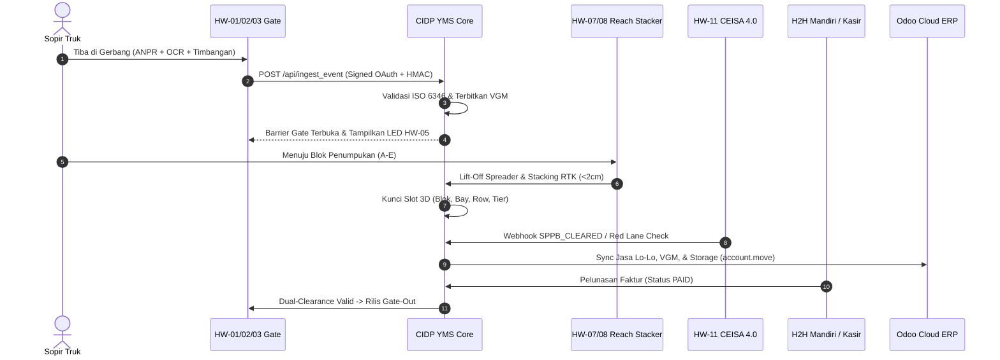

# PRODUCT REQUIREMENTS DOCUMENT (PRD)
# CIDP YARD MANAGEMENT & DATA INTEGRATION SYSTEM (35 Ha)
**Conclusion Intermodal Dry Port (CIDP) — PT Multi Terminal Indonesia / ITL Trisakti**

---

| Parameter Dokumen | Informasi Spesifikasi |
|:---|:---|
| **Judul Produk** | Conclusion Intermodal Dry Port Management System (CIDP DPMS & Data Integration Engine) |
| **Kategori Sistem** | Inland Container Depot (ICD) / Dry Port Operating System, TOS, TMS, WMS, & Data Gateway |
| **Versi Dokumen** | **v2.0 (Living Benchmark Document)** |
| **Status Dokumen** | **APPROVED & ACTIVE BENCHMARK** (Fleksibel & Terkendali) |
| **Terakhir Diperbarui**| 25 Oktober 2026 |
| **Institusi Akademik** | Institut Transportasi dan Logistik (ITL) Trisakti — Program Studi Manajemen Logistik |
| **Mata Kuliah** | Teknologi dan Perangkat Lunak Logistik (Topik 7: ICD & Dry Port Management) |
| **Dosen Pengampu** | **Dr. Tigor Franky, S.T., M.T.** |
| **Entitas Konsultan** | Conclusion Supply Chain & Port Logistics Consultant |

---

## DAFTAR DISTRIBUSI & RACI MATRIX TIM PROYEK

Dokumen ini disusun sebagai **patokan tunggal (Single Source of Truth / SSOT)** agar seluruh divisi, analis bisnis, spesialis perangkat keras, spesialis ERP, dan programmer memiliki pemahaman yang solid, selaras, dan tidak saling berasumsi.

| Anggota Tim | Peran Utama & Divisi | Tanggung Jawab dalam PRD (RACI) |
|:---|:---|:---:|
| **Zulfikar Jafarudin Fatah** | **Lead System Architect & Lead Programmer** | **Accountable (A)** — Menjamin arsitektur sistem, skema database, API gateway, dan implementasi kode berjalan 100% sesuai PRD |
| **Naufal Andika Heditya** | **Business Analyst & QA Specialist** | **Responsible (R)** — Mengawal aturan bisnis, ISO 6346, validasi fungsional, dan skenario pengujian kualitas (QA) |
| **Armansyah Muchtarrom** | **Hardware & Infrastructure Specialist** | **Responsible (R)** — Menentukan spesifikasi teknis 11 hardware, topologi sensor, dan format paket telemetri |
| **Afriansayah Ayubi** | **Software & ERP Process Specialist** | **Responsible (R)** — Menjamin aliran finansial, kalkulasi tarif jasa, dan sinkronisasi live JSON-RPC ke Odoo Cloud ERP |
| **Juan Gamaliel** | **Yard Planning, CFS & Multimodal Specialist** | **Responsible (R)** — Mendesain denah 35 Ha, Digital Twin 3D Bay-Row-Tier, mitigasi CRP, operasional gudang CFS (Rampa D1–D5 & Rak Palet), dan integrasi sepur simpang KA |

> **Prinsip Fleksibilitas Dokumen:** PRD ini bersifat sebagai **patokan utama**. Jika selama pengembangan ditemukan pendekatan teknis yang lebih efisien atau masuk akal untuk kemajuan aplikasi, bagian terkait dapat disesuaikan melalui mekanisme pembaruan terkendali (*Controlled Amendment*) tanpa merusak integritas arsitektur inti.

---

## 1. VISI PRODUK & PRINSIP UTAMA (PRODUCT VISION)

### 1.1 Latar Belakang & Masalah
Operasional pelabuhan pedalaman (*Dry Port*) konvensional sering mengalami inefisiensi akibat:
1. **Pencatatan data ganda (*Re-entry*) & Kesalahan Manusia (*Human Error*)**: Penginputan nomor plat truk dan nomor peti kemas secara manual di gerbang memperlambat *Truck Turnaround Time* (TAT) hingga >45 menit.
2. **Salah Letak Kontainer (*Misplaced Box*)**: Ketidakakuratan penempatan slot di lapangan penumpukan memicu tingginya rasio pergeseran kontainer (*Container Relocation Problem / CRP*) yang membuang bahan bakar alat berat.
3. **Kebocoran Pendapatan (*Revenue Leakage*)**: Aktivitas fisik di lapangan (penimbangan VGM, penumpukan melebihi masa bebas, pemakaian listrik reefer, relokasi yard) sering terlambat atau lupa ditagihkan ke pemilik kargo.
4. **Data Dummy / Silo Informasi**: Sistem visualisasi terminal kerap terputus dari database riil dan modul akuntansi ERP pusat.

### 1.2 Triad Aliran Terpadu (The Dry Port Triad Flow)
CIDP DPMS dirancang dengan mengikat tiga lapisan aliran secara waktu-nyata (*real-time*):

```
┌────────────────────────────────────────────────────────────────────────┐
│ 1. ALIRAN FISIK & HARDWARE (Physical & Sensor Layer)                    │
│ Truk, Kereta Api, Peti Kemas, Reach Stacker, Sensor, Kamera, Timbangan  │
└──────────────────────────────────┬─────────────────────────────────────┘
                                   │ Memicu Sinyal Telemetri (Trigger)
                                   ▼
┌────────────────────────────────────────────────────────────────────────┐
│ 2. ALIRAN INFORMASI & SOFTWARE (CIDP YMS Engine Layer)                 │
│ Ingesti Sensor, Validasi Aturan Bisnis, Pemutakhiran Database MySQL    │
└──────────────────────────────────┬─────────────────────────────────────┘
                                   │ Memicu Transaksi Finansial (Billing)
                                   ▼
┌────────────────────────────────────────────────────────────────────────┐
│ 3. ALIRAN FINANSIAL & KOMERSIAL (Billing ERP & Ledger Layer)            │
│ Tarif Gate Pass, Jasa Lo-Lo, VGM SOLAS, Plugging Listrik, Haulage KA   │
└────────────────────────────────────────────────────────────────────────┘
```

### 1.3 Tiga Pilar Integritas Sistem (Zero Dummy Standard)
1. **100% Zero Dummy Data**: Seluruh angka di Beranda, Denah 2D, Gate, Yard, Reefer, CFS, Customs, Intermodal, dan Billing ditarik murni dari tabel transaksi MySQL dan Odoo Cloud ERP. Tidak diperbolehkan adanya hardcoded baseline fiktif.
2. **Kondisi Awal Pre-Advice di Luar Gerbang (`SCHEDULED`)**: Pada saat sistem di-reset (awal demo), lapangan penumpukan berstatus **0 TEU**, log peristiwa berstatus **0 event**, dan tagihan berstatus **Rp 0**. Terdapat **30 armada truk & kontainer terjadwal di luar pelabuhan kering** (`status = 'SCHEDULED' / 'expected'`) yang merepresentasikan dokumen *EDI 940 Shipping Order / Delivery Order*.
3. **Dual-Clearance Security Interlock**: Truk pembawa kontainer dilarang keras meninggalkan gerbang keluar (*Gate-Out*) apabila:
   - Status kepabeanan belum `SPPB_CLEARED` (Pabean CEISA 4.0 belum rilis).
   - Tagihan operasional kontainer belum lunas (`payment_status != 'PAID'`).

### 1.4 Doktrin Operasional: Terminal Operations Center (TOC) sebagai Pengambil Keputusan Sentral
CIDP beroperasi secara hukum dan logistik sebagai **perpanjangan pelabuhan laut internasional di daratan (*Inland Extension of Seaport*)**. Oleh karena itu, sistem ini wajib mengadopsi standar komando operasional pelabuhan maritim modern:

1. **Sentralisasi Komando & Pengambilan Keputusan**: Segala keputusan pergerakan muatan—mulai dari penetapan jalur gerbang masuk, alokasi blok dan slot 3D di lapangan penumpukan (*bay-row-tier*), penahanan pabean inspeksi fisik (*Red Lane Hold*), penugasan rampa CFS, penyusunan urutan gerbong KA, hingga izin rilis gerbang keluar—**dihasilkan secara eksklusif oleh sistem cerdas di Pusat Kendali / Control Room (*Terminal Operations Center - TOC*)**.
2. **Pola Perintah Kerja Lapangan (*Dispatched Work Orders*)**: Petugas lapangan dan operator alat berat (pengemudi truk, operator Reach Stacker, operator RTG Crane, petugas rampa CFS, operator langsir KA) **bersifat sebagai pelaksana instruksi terarah**. Mereka menerima perintah kerja digital (*digital work orders*) melalui:
   - **VMT (*Vehicle Mounted Terminal*)** pada kabin Reach Stacker & RTG Crane.
   - **HHT (*Handheld Terminal / Mobile Scanner*)** pada petugas tally rampa CFS.
   - **LED Gate Display & Barrier Interlock** pada jalur gerbang masuk/keluar.
3. **Umpan Balik Sensor Tertutup (*Closed-Loop Telemetry Handshake*)**: Operator di lapangan tidak mengambil keputusan sepihak di luar instruksi sistem. Sensor perangkat keras (DGPS/RTK GNSS, twistlock spreader, load cell timbangan, LoRaWAN reefer, axle counter) secara otomatis membaca dan mengirimkan umpan balik telemetri kembali ke Pusat Kendali untuk mengonfirmasi bahwa instruksi TOC telah dieksekusi dengan presisi di koordinat yang tepat.
4. **Hierarki Komando**:
   $$\text{Pusat Kendali (TOC Engine)} \xrightarrow{\text{Disposisi Instruksi}} \text{Perangkat Lapangan (VMT/LED/HHT)} \xrightarrow{\text{Eksekusi}} \text{Sensor IoT} \xrightarrow{\text{Konfirmasi Data}} \text{Database MySQL \& Billing}$$

---

## 2. DUAL-MODE OPERATIONAL ENGINE

Sistem harus mampu beroperasi secara mulus dalam **dua mode eksekusi simultan**:

```
┌────────────────────────────────────────────────────────────────────────┐
│                    CIDP DUAL-MODE OPERATIONAL ENGINE                   │
├──────────────────────────────────┬─────────────────────────────────────┤
│   MODE A: AUTOMATED TELEMETRY    │      MODE B: OPERATOR SOFTWARE      │
│   (Simulasi Sensor Hardware)     │     (Eksekusi Manual Antarmuka)     │
├──────────────────────────────────┼─────────────────────────────────────┤
│ Digunakan untuk mendemokan 11    │ Digunakan saat sensor fisik tidak   │
│ sensor industri. Data dikirimkan │ tersedia di titik tersebut, atau    │
│ via API Gateway dengan envelope  │ ketika petugas operasional perlu    │
│ JSON terotentikasi OAuth 2.0 &   │ melakukan intervensi/input manual   │
│ tanda tangan kriptografi HMAC.   │ langsung pada modul web.            │
└──────────────────────────────────┴─────────────────────────────────────┘
```

- **Kamera Scanner (HW-02)**: Diuji menggunakan **Kamera Webcam Laptop/HP secara nyata** melalui antarmuka HTML5 di modul Scanner.
- **10 Hardware Lainnya**: Karena perangkat fisiknya berada di lapangan/bawah tanah (timbangan 80 ton, sensor gandar rel, RTK reach stacker), aliran datanya disimulasikan melalui **pengiriman JSON Payload terstandarisasi**.
- **Konsistensi Data**: Baik dijalankan via Mode A maupun Mode B, database MySQL dan pencatatan pos tagihan di Billing/Odoo ter-update secara **identik dan sinkron**.

---

## 3. SPESIFIKASI RINCI 11 PERANGKAT KERAS (HARDWARE TELEMETRY MATRIX)

Berikut adalah 11 perangkat keras yang disepakati sesuai dokumen kurikulum ITL Trisakti dan slide presentasi data integration:

```mermaid
flowchart LR
    HW01["HW-01: ANPR Gate"] --> GW["API Gateway (OAuth 2.0 + HMAC)"]
    HW02["HW-02: OCR & Cam Scanner"] --> GW
    HW03["HW-03: Weighbridge 80T"] --> GW
    HW04["HW-04: UHF RFID Reader"] --> GW
    HW05["HW-05: LED Gate Display"] <-- GW
    HW06["HW-06: Edge AI PC"] <--> GW
    HW07["HW-07: RTK GNSS (<2cm)"] --> GW
    HW08["HW-08: Spreader Twistlock"] --> GW
    HW09["HW-09: Smart Reefer 380V"] --> GW
    HW10["HW-10: Frauscher Axle (KA)"] --> GW
    HW11["HW-11: Smart E-Seal CEISA"] --> GW
    GW --> DB[("MySQL cidp_yms")]
    GW --> ERP["Odoo Cloud ERP"]
```

### HW-01: Kamera ANPR Gate (Automatic Number Plate Recognition)
- **Model Acuan:** Hikvision DS-TCG406-E Outdoor IP67
- **Fungsi Fisik:** Membaca plat nomor kendaraan truk saat roda depan menginjak *inductive loop detector* di aspal 5m sebelum gerbang.
- **Spesifikasi JSON Payload:**
  ```json
  {
    "event_type": "TRUCK_GATE_ARRIVAL",
    "truck_plate": "B 9481 UEK",
    "container_number": "MSCU9180379",
    "driver_name": "Bambang Supriyadi",
    "company": "PT Samudera Logistik",
    "lane_id": "GATE-IN-LANE-01"
  }
  ```
- **Dampak Software & Finansial:**
  - Mengubah status `preadvice` menjadi `IN_YARD` dan status `trucks` menjadi `in_yard`.
  - Menerbitkan invoice **Tarif Pas Masuk Gerbang (Gate Pass Fee)** sebesar **Rp 50.000**.

### HW-02: Portal OCR & Scanner ISO 6346 (Kamera Live)
- **Model Acuan:** Hikvision iDS-TCV300-A6I Multi-Angle / HTML5 Web Scanner (`pages/scanner.php`)
- **Fungsi Fisik:** Memindai 4 sudut peti kemas saat melintas gerbang masuk atau pemindaian optik menggunakan kamera webcam operator.
- **Logika Algoritma:** Menjalankan verifikasi algoritma *Check Digit* ISO 6346 Modulo 11:
  $$\text{Check Digit} = \left(\sum_{i=0}^{9} \text{Nilai Karakter}_i \times 2^i\right) \bmod 11$$
- **Dampak Software & Finansial:**
  - Mengubah status kontainer dari `expected` menjadi `in_yard`.
  - Mengaktifkan penghitungan masa bebas biaya penumpukan (*Free Storage Period* 3 hari). Jika lewat masa bebas, argo demurrage berjalan (Rp 180.000/hari untuk 40ft).

### HW-03: Jembatan Timbang Truk 80 Ton (Weighbridge VGM)
- **Model Acuan:** Fangda Electronic Truck Scale 80 Ton Digital Load Cell
- **Fungsi Fisik:** Mengukur bobot kotor truk (*Gross Weight*) saat berhenti 5 detik di platform baja.
- **Spesifikasi JSON Payload:**
  ```json
  {
    "event_type": "TRUCK_WEIGHBRIDGE",
    "truck_plate": "B 9481 UEK",
    "container_number": "MSCU9180379",
    "weight_gross": 34850.0,
    "weight_tare": 14200.0
  }
  ```
- **Dampak Software & Finansial:**
  - Menghitung berat bersih muatan ($\text{Netto} = \text{Bruto} - \text{Tara} = 20.650\text{ kg}$).
  - Menerbitkan sertifikat digital **SOLAS VGM Bab VI Regulasi 2**.
  - Menerbitkan pos tagihan **Jasa Penimbangan VGM SOLAS** sebesar **Rp 75.000** (atau Rp 120.000 bila ad-hoc).

### HW-04: Long-Range UHF RFID Reader
- **Model Acuan:** Industrial UHF RFID Reader 860–960 MHz (Jarak baca 20 meter)
- **Fungsi Fisik:** Membaca kartu *e-Pass Driver* di kaca depan atau tag anti-metal di bodi kontainer secara nirkabel tanpa kontak (*touchless*). Juga membaca label palet GS1 SSCC-18 di gudang CFS.
- **Dampak Software & Finansial:**
  - Validasi otorisasi armada mitra dan auto-debit deposit trucking.
  - Memvalidasi label palet gudang LCL berstandar GS1-128 SSCC-18 (Modulo 10).

### HW-05: LED Information Display Gate
- **Model Acuan:** Chipshow Outdoor P6/P8 Industrial Full-Color LED
- **Fungsi Fisik:** Menampilkan instruksi teks dinamis (hijau/merah/kuning) kepada pengemudi truk di kanopi gerbang:
  - *"MSCU9180379 | SILAHKAN MASUK"*
  - *"TUJUAN: BLOK B / BAY 04 / ROW 02"*
  - *"VGM: 34.850 KG - PASSED"*
- **Dampak Software & Finansial:**
  - Menjamin pergerakan terarah di dalam kawasan terminal, meniadakan antrean liar, dan memangkas TAT armada.

### HW-06: Industrial Edge AI PC Controller
- **Model Acuan:** Advantech ARK-3532 / Neousys Nuvo-9000 Fanless Embedded Box
- **Fungsi Fisik:** Agregasi multi-port (RS-232, Modbus, PoE Gigabit) di tiang gerbang dan pengendali relay Digital Output (PLC) untuk membuka motor palang barrier.
- **Logika Interlock Edge:**
  ```
  JIKA (ANPR Valid) DAN (OCR Check Digit Valid) DAN (VGM <= 35 Ton) DAN (Customs != RED_LANE)
  MAKA:
      Trigger Relai Palang Masuk Terbuka (1.2 detik)
      Kirim Transaksi Signed OAuth 2.0 ke MySQL Central
  JIKA KONEKSI INTERNET MATI:
      Aktifkan Buffer Antrean Lokal (Exponential Backoff Queue 2s -> 4s -> 8s -> 16s)
  ```

### HW-07: DGPS / RTK GNSS Receiver
- **Model Acuan:** CHCNAV CGI-610 Dual-Antenna RTK GNSS + IMU Sensor (<2 cm akurasi)
- **Fungsi Fisik:** Terpasang di kabin Reach Stacker (RS-01 s/d RS-03) untuk memancarkan koordinat presisi tinggi secara kontinu (20 Hz).
- **Dampak Software & Finansial:**
  - Mengonversi data garis lintang/bujur menjadi grid terminal 3D: Blok, Bay, Row, dan Tier.
  - Meniadakan biaya pencarian kontainer salah letak (*Misplaced Box*) yang memakan biaya Rp 150.000–Rp 300.000 per box.

### HW-08: Spreader Twistlock & Load Cell Sensor Kit
- **Model Acuan:** Bromma SmartSpreader / Kalmar Twistlock Proximity & Strain Gauge
- **Fungsi Fisik:** Mendeteksi putaran 4 pin twistlock mengunci lubang sudut peti kemas (`TWISTLOCK_LOCKED = 1`) dan 4 titik strain gauge mengukur beban terangkat.
- **Dampak Software & Finansial:**
  - Otomatis mengubah status kontainer: saat terangkat $\to$ `in_transit`, saat diletakkan di tumpukan $\to$ `in_yard`.
  - Menerbitkan pos tagihan **Jasa Angkat / Lift-Off Fee** sebesar **Rp 250.000** (total paket handling Rp 325.000).

### HW-09: Smart Reefer Socket 380V & LoRaWAN Sensor
- **Model Acuan:** Cavotec / Marechal 380V/32A Decontractor + Sensirion SHT40 LoRaWAN Node
- **Fungsi Fisik:** Mengukur konsumsi daya listrik 3-fasa (Voltase 380V, Arus Ampere, kW, kWh) dan temperatur internal ruang pendingin kontainer di rak reefer zona 300 steker.
- **Logika Alarm SCADA:** Jika deviasi suhu $> 2^\circ\text{C}$ dari setpoint (misal naik dari $-18^\circ\text{C}$ ke $-13.2^\circ\text{C}$), sistem langsung membunyikan sirene alarm, menandai `status = 'ALARM'` di tabel `reefer_telemetry`, dan memicu notifikasi peringatan.
- **Dampak Software & Finansial:**
  - Menerbitkan tagihan **Plugging & Monitoring Fee** sebesar **Rp 35.000 / jam** (tarif listrik industri Rp 2.850 / kWh).
  - Melindungi terminal dari risiko klaim kerusakan komoditas vaksin/daging impor bernilai miliaran rupiah.

### HW-10: Rail Trackside Axle Counter (Penghitung Gandar Rel)
- **Model Acuan:** Frauscher RSR123 Inductive Wheel Sensor
- **Fungsi Fisik:** Terpasang di kepala rel jalur sepur simpang (*rail siding*) 2 x 450m untuk mendeteksi pelek roda lokomotif CC 206 dan gerbong datar PPCW melintas.
- **Logika Gandar:** Menghitung total **126 as roda** (1 lokomotif CC 206 @ 6 as + 30 gerbong datar PPCW @ 4 as = 126 as roda).
- **Dampak Software & Finansial:**
  - Memvalidasi keutuhan rangkaian KA logistik rute Tanjung Priok – Cikarang Hub secara otomatis.
  - Mengubah status kontainer menjadi `on_rail` dan menerbitkan tagihan **Rail Freight Haulage** sebesar **Rp 1.850.000 / TEU**.
  - Menghasilkan perhitungan reduksi emisi karbon **ESG Green Logistics** (penghematan 1.84 Ton $\text{CO}_2$ per rangkaian dibandingkan moda truk jalan tol).

### HW-11: Electronic Cargo Smart Seal (E-Seal Bea Cukai)
- **Model Acuan:** Jointech JT701 GPS/GSM Smart Electronic Lock
- **Fungsi Fisik:** Kawat segel elektronik anti-tamper yang mengunci daun pintu peti kemas pabean sejak keluar dermaga pelabuhan laut Tanjung Priok.
- **Dampak Software & Finansial:**
  - Mengirimkan sinyal integritas segel (`SEAL_INTACT`) ke webhook CEISA 4.0 DJBC.
  - Memungkinkan penerbitan otomatis **SPPB (Surat Persetujuan Pengeluaran Barang)** tanpa pengawalan fisik petugas (*escorting cost* Rp 500.000 / truk dihilangkan).
  - Melepaskan jaminan kepabeanan (*Customs Bond*) importir.

---

## 4. ALUR PROSES OPERASIONAL END-TO-END



### 4.1 Siklus Utama 6 Langkah (Handshake & Zero Re-Entry)
1. **Langkah 1: Gate-In ANPR/OCR/RFID (`TRUCK_GATE_ARRIVAL`)**: Truk berstatus `SCHEDULED` dari luar masuk gerbang. Plat dan nomor kontainer terverifikasi.
2. **Langkah 2: Penimbangan Jembatan Timbang 80T (`TRUCK_WEIGHBRIDGE`)**: Merekam bobot bruto dan tara. Sertifikat SOLAS VGM sah terbit. Faktur penimbangan Rp 75.000 terbentuk.
3. **Langkah 3: Pengangkatan Peti Kemas (`CONTAINER_LIFT`)**: Pin twistlock spreader mengunci box. Status kontainer `in_transit`. Faktur lift-off Rp 250.000 terbentuk.
4. **Langkah 4: Penumpukan di Slot Yard (`CONTAINER_STACK`)**: DGPS/RTK mengunci posisi 3D di Blok tujuan (A/B/C/D/E/Reefer) pada Bay, Row, dan Tier tertentu.
5. **Langkah 5: Klirens Kepabeanan CEISA 4.0 (`CUSTOMS_CEISA`)**: Validasi webhook dokumen PIB/BC 2.3. Kontainer memperoleh status `SPPB_CLEARED`.
6. **Langkah 6: Pelunasan Tagihan & Rilis Gerbang (`PAYMENT_SETTLED` & `TRUCK_GATE_OUT`)**: Faktur diubah menjadi `PAID`. Syarat dual-clearance terpenuhi, palang gerbang keluar terangkat.

### 4.2 Aktivitas Multi-Zona Lapangan
- **Relokasi Stacking Yard (`YARD_RELOCATION`)**: Pergeseran slot oleh Reach Stacker dipandu RTK GNSS untuk mitigasi CRP. Menambah biaya relokasi Rp 200.000 ke faktur.
- **Gudang CFS LCL Konsolidasi (`CFS_STRIPPING_START`, `CFS_PALLET_SCAN`, `CFS_STRIPPING_COMPLETE`, `CFS_PALLET_DISPATCH`)**: Pembongkaran koli LCL di rampa D1–D5. Setiap palet ditempel label barcode GS1 SSCC-18 (Modulo 10 valid). Palet ditahan (*HOLD*) bila kargo kontainer asal belum SPPB.
- **Inspeksi Bea Cukai Jalur Merah (`CUSTOMS_INSPECTION`)**: Deteksi anomali pada pemindai Gantry X-Ray 6 MeV otomatis mengunci kontainer ke status `RED_LANE_CHECK`, memindahkan kontainer ke Blok E (Terminal Behandle), dan membekukan seluruh palet CFS terkait hingga SPPB terbit.
- **Cold Chain Reefer Monitoring (`REEFER_PLUGIN`, `REEFER_TELEMETRY`)**: Pencatatan daya steker 380V dan pemantauan suhu kontinu via LoRaWAN. Deviasi suhu $>2^\circ\text{C}$ memicu event alarm `REEFER_ALARM`.
- **Alih Muat Kereta Api Intermodal (`RAIL_LOADING`)**: Pemuatan kontainer SPPB ke gerbong datar PPCW 42t. Sensor gandar Frauscher memperbarui manifes muatan rangkaian KA 2519.

---

## 5. SPESIFIKASI TEKNIS DATA INTEGRATION & KEAMANAN OAUTH 2.0 (SLIDE 7–12)

Sesuai materi kuliah Dr. Tigor Franky dan presentasi Kelompok 7, integrasi data CIDP mengimplementasikan arsitektur keamanan standar industri:

### 5.1 Arsitektur OAuth 2.0 & Token Server
- **Standar Protokol:** RFC 6749 (OAuth 2.0 Client Credentials Grant) & RFC 7519 (JSON Web Token - JWT).
- **Algoritma Enkripsi:** `HS256` (HMAC with SHA-256) dengan masa berlaku token (*TTL*) **3600 detik (1 jam)**.
- **Endpoint Token Server:** `POST /api/oauth_server.php`
- **Katalog 6 Client Terakreditasi:**
  1. `cidp-edge-gate-01`: Perangkat Gerbang & Timbangan (Scope: `ingest:gate`, `ingest:weighbridge`, `read:preadvice`)
  2. `cidp-edge-yard-fleet`: Telemetri Armada RTK & Spreader (Scope: `yard:stack`, `yard:relocate`, `yard:read`)
  3. `cidp-edge-cfs-wms`: Gudang CFS & Scanner Palet (Scope: `cfs:strip`, `cfs:pallet`, `cfs:read`)
  4. `djbc-ceisa40-h2h`: Host-to-Host Bea Cukai DJBC (Scope: `customs:sppb:write`, `customs:inspect`, `customs:read`)
  5. `erp-odoo-finance-sync`: Jembatan Modul Akuntansi Odoo (Scope: `billing:read`, `billing:settle`, `odoo:sync`)
  6. `cidp-web-portal-ui`: Antarmuka Web Dashboard Utama (Full Operational Scopes)

### 5.2 Cryptographic Trust & Verifikasi HMAC Payload
Untuk mencegah serangan manipulasi data di tengah jalan (*Man-in-the-Middle Attack*), setiap payload JSON wajib menyertakan tanda tangan digital HMAC-SHA256 pada header HTTP:
```
X-Payload-Signature = HMAC-SHA256(Client_Secret, Event_Type + "." + MD5(Canonical_JSON_Payload))
```
Jika peretas memanipulasi bobot kontainer dari 34.850 kg menjadi 20.000 kg, tanda tangan tidak cocok dan API Gateway langsung menolak request dengan status **HTTP 401 Unauthorized** (`hmac_signature_mismatch`).

### 5.3 Idempotency & Deduplication Engine
Untuk mencegah pencatatan ganda akibat transmisi ulang jaringan IoT (*network retry*), API Gateway menerapkan penanda identitas unik:
```
X-Idempotency-Key: CIDP-EVT-{TIMESTAMP}-{UUID}
```
Setiap event yang berhasil diproses dicatat ke tabel `processed_events`. Jika key yang sama dikirimkan kembali, sistem mengembalikan hasil eksekusi sebelumnya tanpa melakukan mutasi database ganda (*Idempotent HTTP 200*).

### 5.4 Dead Letter Queue (DLQ) & Pola Penanganan Error (Slide 9 & 10)
Setiap transaksi sensor yang gagal divalidasi (kontrak JSON cacat, token palsu, truk tak terdaftar, check digit ISO salah) **tidak boleh dibuang diam-diam (*silent drop*)**. Payload yang gagal otomatis dikarantina ke tabel `integration_dlq`:
- **Kode Error:** `INVALID_JSON_CONTRACT`, `ISO6346_INVALID`, `UNREGISTERED_TRUCK`, `HMAC_MISMATCH`, `SCOPE_VIOLATION`, `GATE_OUT_LOCKED`.
- **Fitur Konsol DLQ:** Operator dapat melihat riwayat error, melakukan *Reprocess / Resolve*, atau *Discard*.

### 5.5 Integrasi Odoo Enterprise Cloud ERP (Slide 6 & 12)
- **Host Target:** `https://conclusion-intermodal-dry-port.odoo.com`
- **Protokol:** JSON-RPC 2.0 via `/web/dataset/call_kw`
- **Model Terhubung:**
  - `account.move` (Sinkronisasi Faktur Piutang Pelanggan / Customer Invoice)
  - `product.product` (Katalog Jasa Terminal: Gate Pass, Lo-Lo, Storage, Reefer, Haulage)
  - `res.partner` (Master Data Perusahaan Pelayaran & Trucking)
- **Mekanisme Ketahanan Jaringan (*Resilient Fallback*):** Jika koneksi internet ke cloud Odoo terputus, sistem lokal menerapkan algoritma **Exponential Backoff Retry** ($2\text{s} \to 4\text{s} \to 8\text{s} \to 16\text{s}$) di mana faktur tetap tersimpan aman di tabel lokal `billing_invoices` dan otomatis disinkronkan saat koneksi pulih.

---

## 6. SPESIFIKASI SKEMA DATABASE (DATA DICTIONARY)

Sistem menggunakan database MySQL `cidp_yms` dengan struktur relasional sebagai berikut:

| Nama Tabel | Peran Utama & Kolom Kunci | Keterangan Status / Enum |
|:---|:---|:---|
| `preadvice` | Master reservasi pre-gate truk & kontainer sebelum masuk (`pre_gate_code`, `truck_plate`, `container_number`, `rfid_tag`, `status`) | Status: `SCHEDULED`, `IN_YARD`, `COMPLETED` |
| `trucks` | Data armada truk internal & eksternal (`license_plate`, `driver_name`, `company`, `status`, `weight_gross`, `weight_tare`) | Status: `scheduled`, `queuing`, `at_gate`, `in_yard`, `gate_out` |
| `containers` | Master inventaris peti kemas 3D (`container_number`, `iso_code`, `status`, `block`, `bay`, `row`, `tier`, `customs_status`, `gross_weight_kg`) | Status: `expected`, `in_yard`, `in_transit`, `on_rail`, `gate_out`<br>Pabean: `BC23_TRANSIT`, `SPPB_CLEARED`, `RED_LANE_CHECK`, `DOC_HOLD` |
| `cfs_jobs` | Job order stripping/stuffing gudang CFS (`job_number`, `job_type`, `container_number`, `dock_ramp`, `total_packages`, `status`) | Status: `IN_PROGRESS`, `COMPLETED` |
| `cfs_pallets` | Data palet koli berlabel GS1 di rak CFS (`pallet_sscc`, `container_origin`, `gross_weight_kg`, `rack_location`, `customs_status`, `status`) | Status: `IN_RACK`, `DISPATCHED`<br>Pabean: `CLEARED`, `HOLD` |
| `reefer_telemetry` | Log telemetri steker 380V & sensor suhu LoRaWAN (`container_number`, `socket_id`, `set_temp_c`, `supply_temp_c`, `power_kw`, `kwh_consumed`, `status`) | Status: `NORMAL`, `ALARM` |
| `trains` | Manifest rangkaian kereta api siding rel (`train_code`, `origin`, `destination`, `total_wagons`, `loaded_wagons`, `status`) | Status: `scheduled`, `arrived`, `loading`, `unloading`, `departed` |
| `billing_invoices` | Buku besar tagihan operasional dan pos piutang (`invoice_number`, `container_number`, `customer_name`, `service_type`, `total_amount`, `payment_status`) | Status: `PENDING`, `PAID`, `OVERDUE` |
| `yard_events` | Jejak audit peristiwa telemetri dan log operasional (`event_type`, `container_number`, `equipment_id`, `from_block`, `to_block`, `billable_amount`) | 16+ tipe peristiwa terekam permanen |
| `processed_events` | Tabel idempotensi deduplikasi event (`event_id`, `idempotency_key`, `event_type`, `processed_at`) | Mencegah transaksi ganda dari sensor |
| `integration_dlq` | Karantina payload sensor gagal / error (`event_type`, `error_code`, `error_reason`, `raw_payload`, `status`) | Status: `QUARANTINED`, `RESOLVED`, `DISCARDED` |

---

## 7. PERSYARATAN ANTARMUKA PENGGUNA (UI/UX SCREENS)

Aplikasi memiliki 11 modul antarmuka yang terintegrasi di navigasi sidebar:

1. **Beranda (`pages/beranda.php`)**: Dashboard eksekutif yang memuat 4 kartu metrik utama (TEU Lapangan, Truk Aktif, Reefer Aktif, Job CFS), ringkasan finansial pendapatan, dan visualisasi denah aktif tanpa dummy data.
2. **Denah 2D & Simulator 3D (`pages/denah.php` & `pages/simulator.php`)**: Visualisasi digital twin kawasan dry port 35 Ha berbasis SVG interaktif dan Three.js 3D yang menampilkan posisi real-time alat berat dan kontainer di Blok A s/d E.
3. **Smart Gate (`pages/gate.php`)**: Antarmuka gerbang ANPR & timbangan, daftar antrean Pre-Advice 30 truk terjadwal, form 1-Click Gate-In, dan tombol rilis gerbang keluar.
4. **Stacking Yard (`pages/yard.php`)**: Manajemen penumpukan kontainer Bay-Row-Tier, pemantauan utilisasi lapangan, dan form penugasan relokasi VMT Reach Stacker.
5. **Gudang CFS (`pages/cfs.php`)**: Manajemen rampa loading dock D1–D5, penerbitan job order stripping, registrasi palet GS1 SSCC-18, dan monitoring okupansi rak.
6. **Cold Chain Reefer (`pages/reefer.php`)**: Monitoring daya steker listrik 380V pada 300 steker, grafik telemetri suhu kontinu LoRaWAN, dan panel pengujian alarm SCADA.
7. **Kepabeanan CEISA 4.0 (`pages/customs.php`)**: Pemantauan dokumen pabean BC 2.3 & PIB, penetapan status Jalur Hijau/Merah, dan simulasi pemindai Gantry X-Ray 6 MeV.
8. **Intermodal Rail Siding (`pages/intermodal.php`)**: Pemantauan sepur simpang 2 x 450m, status sensor gandar Frauscher 126 as roda, manifest gerbong datar PPCW, dan form muat/bongkar manual kereta api.
9. **Scanner Optik (`pages/scanner.php`)**: Antarmuka pemindai barcode/QR multiformat berbasis kamera webcam laptop, upload berkas, atau pengujian instan.
10. **Billing & Keuangan (`pages/billing.php`)**: Daftar faktur operasional hasil pemicu sensor, status pembayaran (PENDING/PAID), dan rincian tarif jasa terminal.
11. **Pusat Kendali Data Integration (`pages/integration.php`)**: Panel kendali presentasi dosen yang memuat panduan 4 langkah demo, 5 KPI integrasi, tombol trigger 6 langkah utama & 9 aktivitas lapangan, inspector 3 aliran, modal matriks 11 hardware, uji serangan keamanan OAuth/HMAC, konsol DLQ, dan sinkronisasi live Odoo Cloud.

---

## 8. SKENARIO PENGUJIAN & DEMONSTRASI (QA & SECURITY TEST CASES)

| ID Uji | Skenario Pengujian | Prosedur Uji | Hasil yang Diharapkan |
|:---|:---|:---|:---|
| **TC-01** | **Happy Path: Siklus Lengkap 1 Truk (Step 1–6)** | Klik tombol "Auto-Run 6 Langkah" pada truk berstatus `SCHEDULED`. | Truk masuk gerbang $\to$ tertimbang VGM $\to$ diangkat RS-02 $\to$ ditumpuk di yard $\to$ SPPB terbit $\to$ tagihan lunas. Yard bertambah 1 box, pabean Hijau, tagihan PAID. |
| **TC-02** | **Kamera Scanner Live (HW-02)** | Buka tiket barcode salah satu truk pre-advice, buka menu Scanner Optik, nyalakan webcam, dan arahkan barcode ke kamera. | Kamera mendeteksi barcode nomor kontainer ISO 6346 dalam $<100$ ms, memverifikasi check digit Modulo 11, dan mencocokkan data reservasi secara live. |
| **TC-03** | **Keamanan MITM: Modifikasi Berat Timbangan** | Klik tombol "Uji Serangan 1 (Manipulasi Payload)" di tab OAuth. Payload berat diubah dari 34.850 kg menjadi 20.000 kg dengan tanda tangan lama. | API Gateway menolak request dengan status **HTTP 401 Unauthorized** (`hmac_signature_mismatch`), event tidak masuk ke database operasional, dan payload dikarantina ke DLQ. |
| **TC-04** | **Pelanggaran Scope: Timbangan Menembak Billing** | Klik tombol "Uji Serangan 2 (Pelanggaran Scope)" di tab OAuth. Client `cidp-edge-gate-01` mencoba menembak endpoint `PAYMENT_SETTLED`. | API Gateway menolak request dengan status **HTTP 403 Forbidden** (`insufficient_scope`), transaksi dibatalkan, dan insiden tercatat di DLQ. |
| **TC-05** | **Truk Ilegal / Tanpa Reservasi Pre-Gate** | Klik tombol "Uji Truk Tanpa Pre-Advice" di tab DLQ. Truk plat `B 0000 XXX` mencoba masuk gerbang. | Gateway menolak dengan status **HTTP 422 Unprocessable Entity** (`UNREGISTERED_TRUCK`), palang gerbang tetap terkunci, dan data dicatat ke DLQ. |
| **TC-06** | **Dual-Clearance Interlock di Gate-Out** | Klik tombol "Uji Penolakan Gate-Out" saat kontainer masih berstatus Jalur Merah atau faktur PENDING. | Palang gerbang keluar menolak terbuka (**HTTP 422 Interlock Rejection**). Pengeluaran gerbang hanya diizinkan bila status pabean `SPPB_CLEARED` dan faktur `PAID`. |
| **TC-07** | **Alarm Suhu Reefer Cold Chain** | Klik tombol "Alarm Deviasi Suhu (-13.2°C)" pada panel sensor. | Sistem mencatat pembacaan suhu $-13.2^\circ\text{C}$ ($>2^\circ\text{C}$ di atas setpoint $-18^\circ\text{C}$), status di tabel `reefer_telemetry` menjadi `ALARM`, dan notifikasi merah aktif di dashboard. |
| **TC-08** | **Sinkronisasi Faktur ke Odoo Cloud** | Klik tombol "Tarik Invoice Asli dari Odoo" atau "Sinkronkan Semua Faktur YMS ke Odoo". | Sistem melakukan autentikasi JSON-RPC ke `conclusion-intermodal-dry-port.odoo.com`, menarik invoice `account.move`, dan menampilkan latensi server secara live. |

---

## 9. PROTOKOL PENGELOLAAN PERUBAHAN DOKUMEN (AMENDMENT POLICY)

Untuk menjaga agar PRD ini tetap menjadi **patokan yang dihormati namun tidak kaku**:
1. **Aturan Perubahan:** Setiap anggota tim (BA, HW, ERP, Dev) dapat mengusulkan perubahan jika dalam penulisan kode atau pengujian ditemukan logika teknis yang lebih unggul.
2. **Kriteria Persetujuan:**
   - Perubahan **tidak boleh merusak prinsip Zero Dummy Data**.
   - Perubahan **tidak boleh meniadakan salah satu dari 11 Hardware Telemetri**.
   - Perubahan **tidak boleh melemahkan validasi keamanan OAuth 2.0 & HMAC**.
3. **Pencatatan Versi:** Setiap revisi harus dicatat pada tabel riwayat pembaruan di bagian awal dokumen dengan nomor versi bertahap (misal: v2.1, v2.2).

---
*Dokumen ini diterbitkan oleh Lead System Architect atas kesepakatan bersama seluruh anggota Kelompok 7 Konsultan CIDP untuk presentasi mata kuliah Teknologi dan Perangkat Lunak Logistik ITL Trisakti.*
