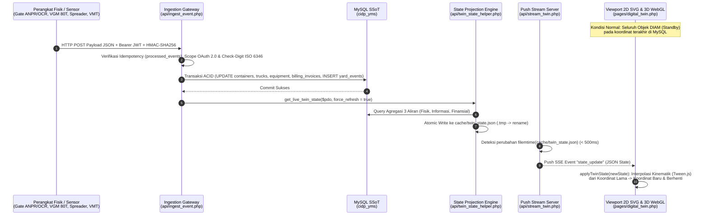
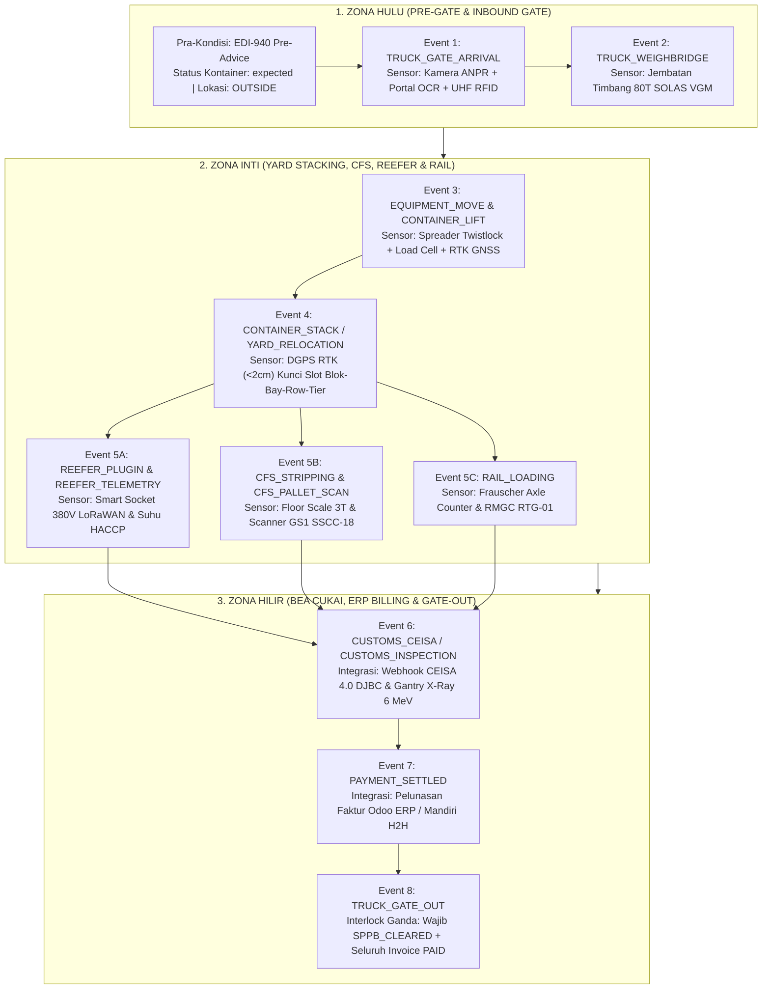

# 🛰️ KONSEP & ARSITEKTUR SISTEM EVENT-DRIVEN DIGITAL TWIN
## Proyek Conclusion Intermodal Dry Port (CIDP) 35 Ha — Yard Management System (YMS)

**Dokumen:** Blueprint Arsitektur & Spesifikasi Teknis Event-Driven Digital Twin (`Data Nyata`)  
**Modul Implementasi:** `pages/digital_twin.php`, `api/ingest_event.php`, `api/twin_state_helper.php`, `api/stream_twin.php`  
**Prinsip Utama:** *Zero Random Looping • 100% Telemetry & Transaction Driven • Dual-Mode 2D/3D Spatial Sync*

---

## 1. Filosofi Dasar: Perbedaan *3D Sandbox Simulator* vs *Event-Driven Digital Twin*

Pada arsitektur sistem **CIDP DPMS 35 Ha**, visualisasi spasial dipisahkan secara tegas menjadi dua mode dengan tujuan yang berbeda agar data operasional produksi tidak pernah tercampur dengan animasi demonstrasi:

| Aspek Arsitektur | Simulator 3D (`pages/simulator.php`) | Event-Driven Digital Twin (`pages/digital_twin.php`) |
| :--- | :--- | :--- |
| **Sumber Pergerakan** | *Autonomous Traffic Loop* (animasi kontinu di sisi klien untuk eksplorasi tata letak 35 Ha). | **100% Event-Driven (Zero Random Looping)**: objek diam (*standby*) hingga ada paket data/event aktual yang masuk ke server. |
| **Sifat terhadap Database** | *100% Read-Only Sandbox* (tidak mengubah MySQL). | **Real-Time Bidirectional SSoT**: setiap perubahan posisi dan status mencerminkan keadaan tabel MySQL `cidp_yms` detik itu juga. |
| **Protokol Sinkronisasi** | Snapshot awal (`GET /api/simulator_action.php`). | **Server-Sent Events (SSE)** (`GET /api/stream_twin.php`) + Atomic State Snapshot (`cache/twin_state.json`). |
| **Korelasi 3 Aliran** | Fokus pada aliran fisik & tata letak sipil. | **Tri-Flow Synchronization**: Aliran Fisik (2D/3D), Aliran Informasi (OCR/RFID/CEISA/IoT), dan Aliran Finansial (Akrual Billing ERP). |

---

## 2. Arsitektur *Real-Time State Synchronization* (Event-Driven Pipeline)

Agar visualisasi Digital Twin **murni merespons trigger data aktual** tanpa *polling* berat yang membebani database, sistem menerapkan pola **Event-Sourced State Projection** dengan **Atomic File Cache** dan **Server-Sent Events (SSE)**:



### Keunggulan Teknis Arsitektur Ini:
1. **Zero Random Motion (Deterministic State Machine):**
   - Di sisi klien (`pages/digital_twin.php`), variabel `sprites[unit]` menyimpan `(currentX, currentY)` dan `(targetX, targetY)`.
   - Selama tidak ada event baru dari `api/stream_twin.php`, nilai `current == target` sehingga kecepatan gerak $\Delta v = 0$ (alat berat, truk, dan palang gerbang **diam sempurna**).
   - Begitu event baru masuk (misalnya `EQUIPMENT_MOVE` atau `CONTAINER_STACK`), `targetX` dan `targetY` diperbarui sesuai koordinat GPS/blok terbaru dari database; objek bergerak halus menggunakan interpolasi menuju titik sasaran, lalu kembali **berhenti (`STANDBY`)** tepat di koordinat baru tersebut.
2. **Keamanan & Validasi Kontrak Data di Hulu (`api/ingest_event.php`):**
   - Setiap paket sensor wajib melewati verifikasi **OAuth 2.0 JWT Scope**, tanda tangan **HMAC-SHA256**, **Idempotency Guard** (`processed_events`), dan validasi **ISO 6346 Modulo-11**.
   - Jika payload cacat atau tidak sah, transaksi ditolak ke **Dead Letter Queue (`integration_dlq`)** dan Digital Twin **tidak bergerak** (mencegah *ghost movement* atau anomali visual).

---

## 3. *End-to-End Operational Mapping* (Pemetaan Operasional Hulu ke Hilir)

Seluruh siklus hidup peti kemas dan pergerakan armada di dalam terminal 35 Ha dipetakan ke dalam **8 Tahap Event Operasional** yang mengubah state basis data, posisi spasial 2D/3D, dan buku besar tagihan secara atomik:



### Matriks Transisi State, Reaksi Visual 2D/3D, dan Akrual Finansial per Event

| No | Nama Event (`event_type`) | Perangkat Pengirim (`source_device`) | Mutasi Database SSoT (`cidp_yms`) | Reaksi Visual Presisi pada Digital Twin (2D & 3D) | Dampak Informasi & Finansial (Tri-Flow) |
| :-: | :--- | :--- | :--- | :--- | :--- |
| **1** | `TRUCK_GATE_ARRIVAL` | Gate Control System (`ANPR` + `OCR` + `RFID`) | `preadvice.status='ARRIVED'`; `trucks.status='at_gate'`; `containers.status='in_transit', block='GATE'` | • Truk muncul & bergerak ke lajur Gate-In `(X:800, Y:82)`<br/>• Sinar laser portal OCR menyala<br/>• Palang `gateBarrierIn` berputar terbuka $90^\circ$ | Mencocokkan plat & nomor kontainer ISO 6346 dengan booking tanpa ketik ulang (*Zero Re-Entry*). |
| **2** | `TRUCK_WEIGHBRIDGE` | SOLAS VGM Weighbridge 80T (RS-232) | `trucks.weight_gross`, `trucks.status='in_yard'`; `containers.gross_weight_kg` | • Palang Gate-In menutup kembali<br/>• Layar indikator jembatan timbang menampilkan tonase aktual (mis. `34.85 T`)<br/>• Truk bergerak menuju Transfer Lane Blok tujuan `(X:480, Y:142)` | Menerbitkan sertifikat berat kotor **SOLAS VGM** & mengakruasi faktur **Biaya Timbang VGM (Rp 75.000)**. |
| **3** | `CONTAINER_LIFT` | Spreader Twistlock & Load Cell + VMT (`RS-01..04` / `RTG`) | `equipment.status='carrying'`, `current_container=CN`, `gps_x/y` diperbarui; `trucks.status='loading'` | • Unit alat berat bergerak ke posisi truk<br/>• Lengan *boom* / *spreader* 3D turun mengunci kontainer<br/>• Mesh kontainer di atas sasis truk berpindah ke spreader alat berat (`LOCKED`) | Sensor *twistlock* mengonfirmasi pengangkatan fisik & mengakruasi **Tarif Lift-Off (Rp 325.000)**. |
| **4** | `CONTAINER_STACK` / `YARD_RELOCATION` | DGPS RTK GNSS Receiver (`< 2 cm`) | `containers.status='in_yard'`, `block`, `bay`, `row`, `tier` terkunci; `equipment.status='idle'`, `current_container=NULL` | • Spreader melepas kontainer (`UNLOCKED`)<br/>• Mesh 3D & sel 2D kontainer muncul presisi pada koordinat **Blok–Bay–Row–Tier** (tinggi $Y$ sesuai `tier`) | Argo *Dwell Time* mulai berjalan; relokasi antar-blok mengakruasi **Biaya Relokasi (Rp 200.000)**. |
| **5** | `REEFER_PLUGIN` / `REEFER_TELEMETRY` | Smart Reefer Socket 380V (LoRaWAN / Modbus) | `reefer_telemetry` (`socket_id`, `set_temp_c`, `supply_temp_c`, `power_kw`, `status`) | • Kontainer pada Blok `REEFER` menampilkan indikator suhu dingin live (`-18.0°C`)<br/>• Jika deviasi $> 2^\circ\text{C}$, warna kontainer & badge berkedip merah (`ALARM`) | Mencatat log rantai dingin HACCP & mengakruasi **Tagihan Listrik Reefer per kWh**. |
| **6** | `CFS_STRIPPING_START` / `CFS_PALLET_SCAN` / `CFS_STRIPPING_COMPLETE` / `CFS_PALLET_DISPATCH` | Timbangan Lantai 3T & Scanner GS1 Gudang CFS | `cfs_jobs.status`, `cfs_pallets` (`pallet_sscc` Modulo-10, `rack_location`), `equipment` (`FL-01..04`, `CDP-TT-01`) | • Kontainer dirapatkan `CDP-TT-01` & `FL-03` ke rampa `CFS` (`D1–D5`)<br/>• Di dalam **Cutaway 3D Gudang CFS 4.000 m²**, `FL-01` menimbang palet di **Floor Scale 3.0T** dan `FL-04` menyusun palet 3D ke rak **`AISLE-A..F`** (`Tier 1..3`)<br/>• Saat `CFS_PALLET_DISPATCH`, palet dikeluarkan dari rak menuju rampa muat | Menjamin keterlacakan *container-to-pallet* (`GS1 SSCC-18`) & mengakruasi **Biaya Handling LCL CFS (`Rp 450.000/kontainer + Rp 85.000/palet`)**. |
| **7** | `CUSTOMS_CEISA` / `CUSTOMS_INSPECTION` | Webhook H2H DJBC CEISA 4.0 & X-Ray 6 MeV | `containers.customs_status='SPPB_CLEARED'` atau `'RED_LANE_CHECK'` | • Kontainer `SPPB_CLEARED` diberi cincin/aksen visual **Hijau** (siap keluar)<br/>• Kontainer `RED_LANE_CHECK` diberi aksen **Merah** (`HOLD` di Blok E Behandle) | Mengunci atau membuka syarat kepabeanan pada *Gate-Out Interlock*. |
| **8** | `PAYMENT_SETTLED` & `TRUCK_GATE_OUT` | ERP Odoo / Bank H2H & Barrier Gate Outbound | `billing_invoices.payment_status='PAID'`; `containers.status='gate_out'`, `trucks.status='gate_out'` | • Argo pendapatan *Paid* bertambah disertai animasi notifikasi pembayaran<br/>• Setelah **Dual-Clearance** (`SPPB_CLEARED` + `PAID`) terpenuhi, palang Gate-Out terbuka & kontainer keluar dari slot yard | Menutup siklus komersial kontainer dengan jaminan **0% Revenue Leakage**. |

---

## 4. Rancangan Antarmuka & Visualisasi Presisi (Hybrid 2D Interaktif & 3D WebGL)

Antarmuka Digital Twin (`pages/digital_twin.php`) dirancang dengan pendekatan **Hybrid Spatial Control Console** yang menggabungkan presisi skematik 2D dengan kedalaman volumetrik 3D:

```
+---------------------------------------------------------------------------------------------------+
| [HEADER BAR] Status: SSE STREAM LIVE (<35ms) | Mode: [3D WebGL | 2D Blueprint] | State: STANDBY   |
+---------------------------------------------------------------------------------------------------+
| [TELEMETRY DISPATCH BAR] Pilih Unit (RS/RTG/FL/Shuttle) -> Kirim Koordinat / Trigger Event 1-6    |
+-------------------------------------------------------------------+-------------------------------+
|                                                                   | [PANEL KANAN: TRI-FLOW HUD]   |
|   VIEWPORT UTAMA (DUAL-ENGINE: 3D THREE.JS / 2D INTERACTIVE SVG)  |                               |
|                                                                   | 1. ALIRAN FISIK & CAN-BUS     |
|   • Zona Gate In/Out: Palang Barrier Pivot, Sinar Laser OCR,      |    - Koordinat RTK (X, Y)     |
|     Indikator Tonase Jembatan Timbang 80T.                        |    - Status Twistlock Spreader|
|   • Lapangan Stacking Blok A-E & Reefer:                          |    - BBM / Daya Grid (%)      |
|     Render volumetrik Bay-Row-Tier (Tier 1..4 ditumpuk vertikal   |                               |
|     pada sumbu Y di 3D, dan kode warna status di 2D/3D).          | 2. ALIRAN INFORMASI (AIDC)    |
|   • Armada Alat Berat (RS, E-RTG, Forklift, Shuttle):             |    - Plat ANPR & Box ISO 6346 |
|     Floating HTML/SVG Badge di atas setiap unit yang menampilkan  |    - Status CEISA 4.0 (SPPB)  |
|     ID Alat, Status (STANDBY / OPERATING / CARRYING), & No. Box.  |    - Suhu Reefer LoRaWAN (°C) |
|   • Rail Siding KA Pasoso: Gerbong datar PPCW & Gantry RTG-01.    |                               |
|                                                                   | 3. ALIRAN FINANSIAL (ERP)     |
|   [Kamera Preset: Overview | Gate VGM | Yard | Rail | Follow RS]  |    - Total Revenue Accrued    |
|   [Raycaster Click Inspector: Klik Box/Alat -> Popup Metadata]    |    - Rincian LoLo, VGM, Reefer|
+-------------------------------------------------------------------+-------------------------------+
| [ANTRIAN KERJA VMT PER ALAT] RS-01 | RS-02 | RS-03 | RTG-01  +  [LIVE EVENT AUDIT STREAM LOG]     |
+---------------------------------------------------------------------------------------------------+
```

### Detail Rekayasa Visualisasi 2D & 3D:

1. **Sistem Koordinat Terpadu (*Unified Spatial Coordinate Mapping*):**
   - Peta 2D SVG menggunakan kanvas koordinat master `1000 × 680` piksel yang didefinisikan pada `pages/layout_master.php`.
   - Kanvas 3D WebGL (`Three.js`) memetakan koordinat 2D $(X_{\text{svg}}, Y_{\text{svg}})$ secara matematis ke bidang tanah 3D $(X_{\text{3D}}, 0, Z_{\text{3D}})$ melalui fungsi transformasi linier `svgTo3D(svgX, svgY)` sehingga posisi setiap kontainer dan alat berat **100% berimpit** antara tampilan 2D dan 3D.

2. **Representasi Presisi Slot `Blok–Bay–Row–Tier` & Kode Warna Status:**
   - Setiap kontainer di `state.physical.active_slots` dirender pada koordinat bloknya dengan offset `Bay` (sumbu memanjang), `Row` (sumbu melintang), dan `Tier` (ketinggian tumpukan $Y = (\text{tier}-1) \times \Delta h$).
   - **Kode Warna Semantik (*Role-Flow Color Coding*):**
     - **Biru (`#0170b9`):** Kontainer *Dry* tersimpan normal di yard (`stored`).
     - **Cyan (`#06b6d4`):** Kontainer *Reefer Cold Chain* terhubung steker 380V.
     - **Hijau Emerald (`#10b981`):** Kontainer telah `SPPB_CLEARED` & lunas (`PAID`) — siap diangkut keluar (`load_out`).
     - **Merah Rose (`#e11d48`):** Kontainer tertahan *Jalur Merah Bea Cukai* (`RED_LANE_CHECK`) atau mengalami *Alarm Suhu Reefer* (`hold`).

3. **Inspeksi Objek Interaktif (*3D Raycasting & 2D Click Inspector*):**
   - Saat operator mengeklik mesh kontainer atau unit alat berat di layar 3D/2D, sistem menembakkan `THREE.Raycaster` dari posisi kursor ke objek 3D dan menampilkan **Floating Asset Inspector Card** yang memuat:
     - Nomor Kontainer (`container_number`), Ukuran/Tipe ISO, dan Pemilik (`owner_company`).
     - Posisi Presisi (`Blok-Bay-Row-Tier`) & Berat Kotor VGM (`gross_weight_kg`).
     - Status Kepabeanan (`customs_status`), Status Tagihan (`billing`), serta Suhu Aktual jika merupakan kontainer Reefer.

4. **Indikator Status Gerak Real-Time (*Motion State Telemetry Badge*):**
   - Header Digital Twin dilengkapi indikator `#twinMotionStateBadge`:
     - Saat tidak ada transaksi baru: **`Standby: Menunggu Data Masuk`** (abu-abu tenang, seluruh objek statis).
     - Saat paket SSE tiba dan objek sedang berinterpolasi menuju koordinat baru: **` bergerak merespons event [NAMA_EVENT]`** (oranye aktif), lalu otomatis kembali ke **`Standby`** setelah interpolasi selesai.
